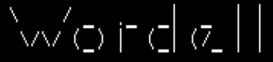
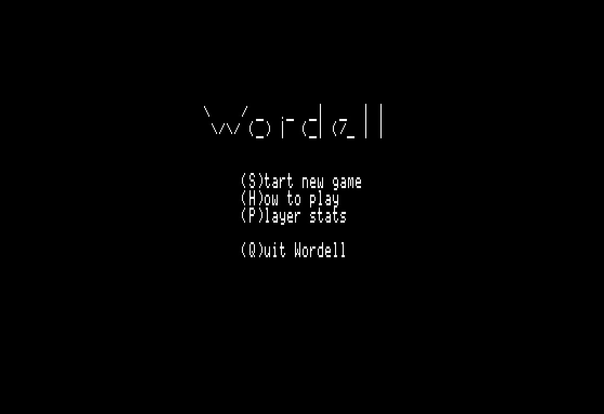
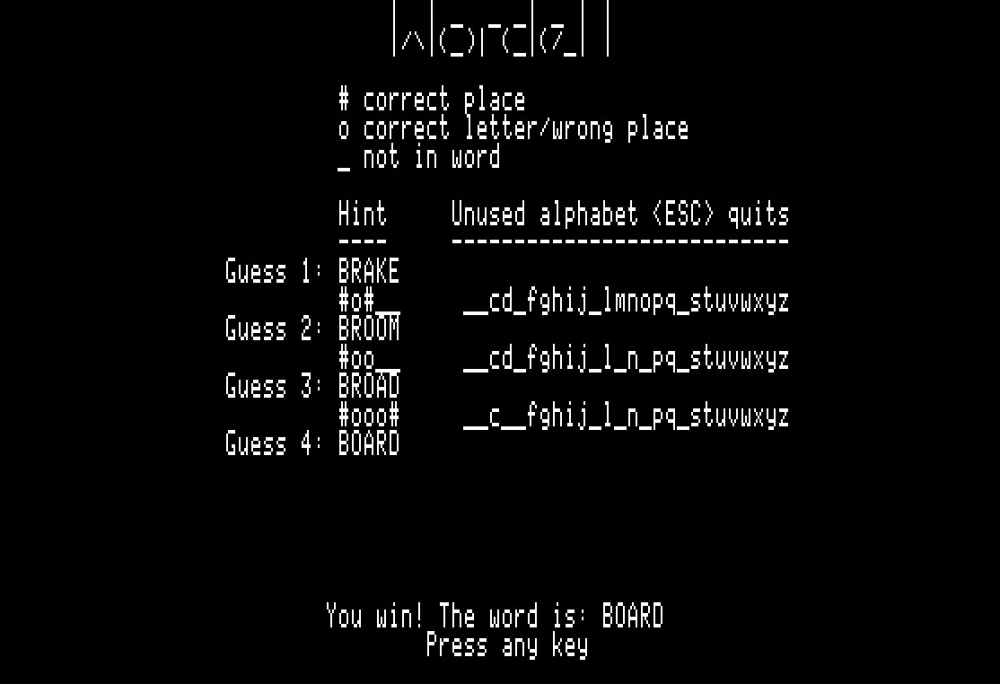
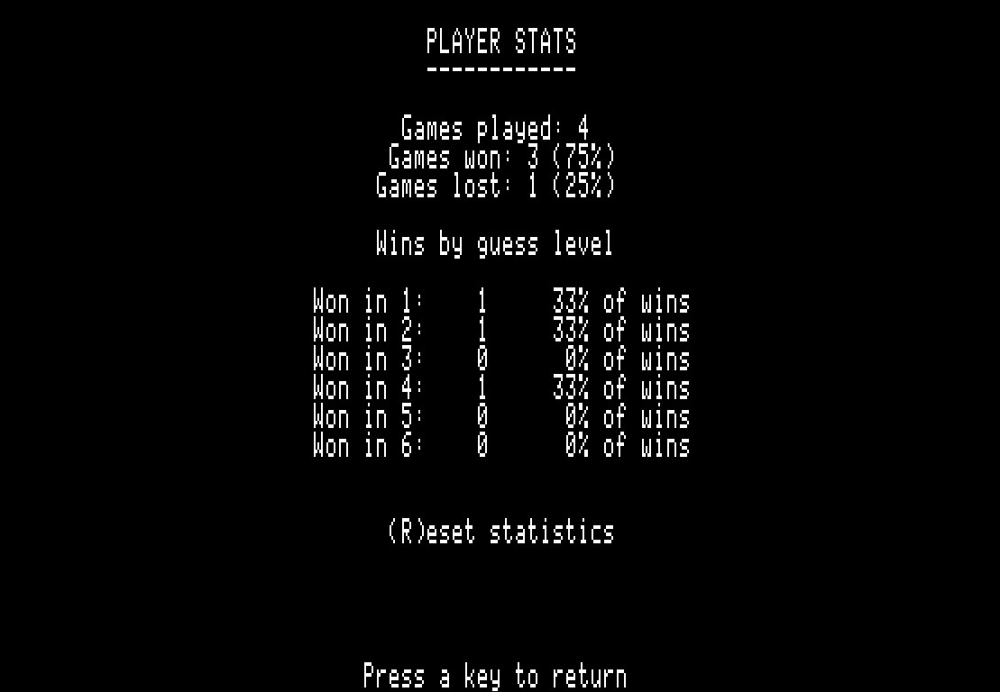

<!--
Wordell is a Wordle clone for Apple II written in
[CC65](https://cc65.github.io/doc/apple2.html) and Assembly.
It features 2,315 possible unique games. It requires 64kb and an
80 column card. File system is [ProDOS 2.4.3](https://prodos8.com/).
The main target is Apple //e. It may work on a ][+ with an 80 column
card, but that hasn't been tested. All testing was done on real
hardware running
[Apple II Desktop](https://www.a2desktop.com/).
-->
𝚆𝚘𝚛𝚍𝚎𝚕𝚕 𝚒𝚜 𝚊 𝚆𝚘𝚛𝚍𝚕𝚎 𝚌𝚕𝚘𝚗𝚎 𝚏𝚘𝚛 𝙰𝚙𝚙𝚕𝚎 𝙸𝙸 𝚠𝚛𝚒𝚝𝚝𝚎𝚗 𝚒𝚗
[CC65](https://cc65.github.io/doc/apple2.html) 𝚊𝚗𝚍 𝙰𝚜𝚜𝚎𝚖𝚋𝚕𝚢.
𝙸𝚝 𝚏𝚎𝚊𝚝𝚞𝚛𝚎𝚜 𝟸,𝟹𝟷𝟻 𝚙𝚘𝚜𝚜𝚒𝚋𝚕𝚎 𝚞𝚗𝚒𝚚𝚞𝚎 𝚐𝚊𝚖𝚎𝚜. 𝙸𝚝 𝚛𝚎𝚚𝚞𝚒𝚛𝚎𝚜 𝟼𝟺𝚔𝚋 𝚊𝚗𝚍 𝚊𝚗
80 column card. 𝙵𝚒𝚕𝚎 𝚜𝚢𝚜𝚝𝚎𝚖 𝚒𝚜 [PʀᴏDOS 2.4.3](https://prodos8.com/).
𝚃𝚑𝚎 𝚖𝚊𝚒𝚗 𝚝𝚊𝚛𝚐𝚎𝚝 𝚒𝚜 𝙰𝚙𝚙𝚕𝚎 //𝚎. 𝙸𝚝 𝚖𝚊𝚢 𝚠𝚘𝚛𝚔 𝚘𝚗 𝚊 ][+ 𝚠𝚒𝚝𝚑 𝚊𝚗 𝟾𝟶 𝚌𝚘𝚕𝚞𝚖𝚗
𝚌𝚊𝚛𝚍, 𝚋𝚞𝚝 𝚝𝚑𝚊𝚝 𝚑𝚊𝚜𝚗'𝚝 𝚋𝚎𝚎𝚗 𝚝𝚎𝚜𝚝𝚎𝚍. 𝙰𝚕𝚕 𝚝𝚎𝚜𝚝𝚒𝚗𝚐 𝚠𝚊𝚜 𝚍𝚘𝚗𝚎 𝚘𝚗 𝚛𝚎𝚊𝚕
𝚑𝚊𝚛𝚍𝚠𝚊𝚛𝚎 𝚛𝚞𝚗𝚗𝚒𝚗𝚐
[Aᴘᴘʟᴇ II Dᴇꜱᴋᴛᴏᴘ](https://www.a2desktop.com/).

<!-- 
Shoutout to other Wordle clones for Apple II:
Untitled Word Game Pro
by 4am
-->
### 𝚂𝚑𝚘𝚞𝚝𝚘𝚞𝚝 𝚝𝚘 𝚘𝚝𝚑𝚎𝚛 𝚆𝚘𝚛𝚍𝚕𝚎 𝚌𝚕𝚘𝚗𝚎𝚜 𝚏𝚘𝚛 𝙰𝚙𝚙𝚕𝚎 𝙸𝙸:
[Uɴᴛɪᴛʟᴇᴅ Wᴏʀᴅ Gᴀᴍᴇ Pʀᴏ](https://github.com/a2-4am/untitled-word-game-pro)
𝚋𝚢 𝟺𝚊𝚖<br><br>

<!--
### Wordell for Apple II is also the base code for all other versions of Wordell
-->
### 𝚆𝚘𝚛𝚍𝚎𝚕𝚕 𝚏𝚘𝚛 𝙰𝚙𝚙𝚕𝚎 𝙸𝙸 𝚒𝚜 𝚊𝚕𝚜𝚘 𝚝𝚑𝚎 𝚋𝚊𝚜𝚎 𝚌𝚘𝚍𝚎 𝚏𝚘𝚛 𝚊𝚕𝚕 𝚘𝚝𝚑𝚎𝚛 𝚟𝚎𝚛𝚜𝚒𝚘𝚗𝚜 𝚘𝚏 𝚆𝚘𝚛𝚍𝚎𝚕𝚕

<!--  
Currently these are:
Wordell for MS-DOS 3.3
Wordell for Windows 1.0
Wordell for Windows 2.0
-->
𝙲𝚞𝚛𝚛𝚎𝚗𝚝𝚕𝚢 𝚝𝚑𝚎𝚜𝚎 𝚊𝚛𝚎:

[Wᴏʀᴅᴇʟʟ ꜰᴏʀ MS-DOS 3.3](https://github.com/mpower-codeworks/WORDELL-Wordle-Clone-for-MS-DOS-3.3)

[Wᴏʀᴅᴇʟʟ ꜰᴏʀ Wɪɴᴅᴏᴡꜱ 1.0](https://github.com/mpower-codeworks/WORDELL-Wordle-Clone-for-Windows-1.0)

[Wᴏʀᴅᴇʟʟ ꜰᴏʀ Wɪɴᴅᴏᴡꜱ 2.0](https://github.com/mpower-codeworks/WORDELL-Wordle-Clone-for-Windows-2.0)


<!-- ### Screenshots -->
## 𝚂𝚌𝚛𝚎𝚎𝚗𝚜𝚑𝚘𝚝𝚜

<table>
    <tr>
        <td align="left" width="50%" valign="middle">
            <br>
        </td>
        <td align="left" width="50%" valign="middle">
            <br>
        </td>
    </tr>
    <tr>
        <td align="left" width="50%" valign="middle">
            <br>
        </td>
        <td align="left" width="50%" valign="middle">
            <br>
        </td>
    </tr>
</table>


<!-- Wordell uses two word lists: -->
## 𝚆𝚘𝚛𝚍𝚎𝚕𝚕 𝚞𝚜𝚎𝚜 𝚝𝚠𝚘 𝚠𝚘𝚛𝚍 𝚕𝚒𝚜𝚝𝚜: 

<!--  
- `ALL.TXT` - 12,947 words accepted as guesses.
- `SOLUTION.TXT` - 2,315 words that can be selected as answers.

The Apple II does not read these text files directly. They
are converted on a modern PC into fixed 5-byte records.

At startup Wordell opens `ALL5.BIN` and `SOL5.BIN`. Pressing **S**
starts a timer-based random seed. A solution number is selected and
exactly five bytes are read from `SOL5.BIN`.

Guess validation is kept small and fast. Only the matching first-letter
group from `ALL5.BIN` is loaded into RAM. `FASTWORD.S` then searches
that RAM buffer in 6502 assembly.
-->

- `ALL.TXT` - 𝟷𝟸,𝟿𝟺𝟽 𝚠𝚘𝚛𝚍𝚜 𝚊𝚌𝚌𝚎𝚙𝚝𝚎𝚍 𝚊𝚜 𝚐𝚞𝚎𝚜𝚜𝚎𝚜.
- `SOLUTION.TXT` - 𝟸,𝟹𝟷𝟻 𝚠𝚘𝚛𝚍𝚜 𝚝𝚑𝚊𝚝 𝚌𝚊𝚗 𝚋𝚎 𝚜𝚎𝚕𝚎𝚌𝚝𝚎𝚍 𝚊𝚜 𝚊𝚗𝚜𝚠𝚎𝚛𝚜.

𝚃𝚑𝚎 𝙰𝚙𝚙𝚕𝚎 𝙸𝙸 𝚍𝚘𝚎𝚜 𝚗𝚘𝚝 𝚛𝚎𝚊𝚍 𝚝𝚑𝚎𝚜𝚎 𝚝𝚎𝚡𝚝 𝚏𝚒𝚕𝚎𝚜 𝚍𝚒𝚛𝚎𝚌𝚝𝚕𝚢. 𝚃𝚑𝚎𝚢
𝚊𝚛𝚎 𝚌𝚘𝚗𝚟𝚎𝚛𝚝𝚎𝚍 𝚘𝚗 𝚊 𝚖𝚘𝚍𝚎𝚛𝚗 𝙿𝙲 𝚒𝚗𝚝𝚘 𝚏𝚒𝚡𝚎𝚍 𝟻-𝚋𝚢𝚝𝚎 𝚛𝚎𝚌𝚘𝚛𝚍𝚜.

𝙰𝚝 𝚜𝚝𝚊𝚛𝚝𝚞𝚙 𝚆𝚘𝚛𝚍𝚎𝚕𝚕 𝚘𝚙𝚎𝚗𝚜 `ALL5.BIN` 𝚊𝚗𝚍 `SOL5.BIN`. 𝙿𝚛𝚎𝚜𝚜𝚒𝚗𝚐 **𝚂**
𝚜𝚝𝚊𝚛𝚝𝚜 𝚊 𝚝𝚒𝚖𝚎𝚛-𝚋𝚊𝚜𝚎𝚍 𝚛𝚊𝚗𝚍𝚘𝚖 𝚜𝚎𝚎𝚍. 𝙰 𝚜𝚘𝚕𝚞𝚝𝚒𝚘𝚗 𝚗𝚞𝚖𝚋𝚎𝚛 𝚒𝚜 𝚜𝚎𝚕𝚎𝚌𝚝𝚎𝚍 𝚊𝚗𝚍
𝚎𝚡𝚊𝚌𝚝𝚕𝚢 𝚏𝚒𝚟𝚎 𝚋𝚢𝚝𝚎𝚜 𝚊𝚛𝚎 𝚛𝚎𝚊𝚍 𝚏𝚛𝚘𝚖 `𝚂SOL5.BIN`.

𝙶𝚞𝚎𝚜𝚜 𝚟𝚊𝚕𝚒𝚍𝚊𝚝𝚒𝚘𝚗 𝚒𝚜 𝚔𝚎𝚙𝚝 𝚜𝚖𝚊𝚕𝚕 𝚊𝚗𝚍 𝚏𝚊𝚜𝚝. 𝙾𝚗𝚕𝚢 𝚝𝚑𝚎 𝚖𝚊𝚝𝚌𝚑𝚒𝚗𝚐 𝚏𝚒𝚛𝚜𝚝-𝚕𝚎𝚝𝚝𝚎𝚛
𝚐𝚛𝚘𝚞𝚙 𝚏𝚛𝚘𝚖 `ALL5.BIN` 𝚒𝚜 𝚕𝚘𝚊𝚍𝚎𝚍 𝚒𝚗𝚝𝚘 𝚁𝙰𝙼. `FASTWORD.S` 𝚝𝚑𝚎𝚗 𝚜𝚎𝚊𝚛𝚌𝚑𝚎𝚜
𝚝𝚑𝚊𝚝 𝚁𝙰𝙼 𝚋𝚞𝚏𝚏𝚎𝚛 𝚒𝚗 𝟼𝟻𝟶𝟸 𝚊𝚜𝚜𝚎𝚖𝚋𝚕𝚢.

<!--  
## Hints use:

- `#` - correct letter and position
- `o` - correct letter, wrong position
- `_` - letter not in the word

Used letters are removed from the visible
alphabet as the game progresses.
-->
## 𝙷𝚒𝚗𝚝𝚜 𝚞𝚜𝚎:

- `#` - 𝚌𝚘𝚛𝚛𝚎𝚌𝚝 𝚕𝚎𝚝𝚝𝚎𝚛 𝚊𝚗𝚍 𝚙𝚘𝚜𝚒𝚝𝚒𝚘𝚗
- `𝚘` - 𝚌𝚘𝚛𝚛𝚎𝚌𝚝 𝚕𝚎𝚝𝚝𝚎𝚛, 𝚠𝚛𝚘𝚗𝚐 𝚙𝚘𝚜𝚒𝚝𝚒𝚘𝚗
- `_` - 𝚕𝚎𝚝𝚝𝚎𝚛 𝚗𝚘𝚝 𝚒𝚗 𝚝𝚑𝚎 𝚠𝚘𝚛𝚍

𝚄𝚜𝚎𝚍 𝚕𝚎𝚝𝚝𝚎𝚛𝚜 𝚊𝚛𝚎 𝚛𝚎𝚖𝚘𝚟𝚎𝚍 𝚏𝚛𝚘𝚖 𝚝𝚑𝚎 𝚟𝚒𝚜𝚒𝚋𝚕𝚎
𝚊𝚕𝚙𝚑𝚊𝚋𝚎𝚝 𝚊𝚜 𝚝𝚑𝚎 𝚐𝚊𝚖𝚎 𝚙𝚛𝚘𝚐𝚛𝚎𝚜𝚜𝚎𝚜.


<!--  
Player stats are recorded in `WORDLE.INI` at the end
of each game. These can be reset to zero at any time.
-->
𝙿𝚕𝚊𝚢𝚎𝚛 𝚜𝚝𝚊𝚝𝚜 𝚊𝚛𝚎 𝚛𝚎𝚌𝚘𝚛𝚍𝚎𝚍 𝚒𝚗 `𝚆𝙾𝚁𝙳𝙻𝙴.𝙸𝙽𝙸` 𝚊𝚝 𝚝𝚑𝚎 𝚎𝚗𝚍
𝚘𝚏 𝚎𝚊𝚌𝚑 𝚐𝚊𝚖𝚎. 𝚃𝚑𝚎𝚜𝚎 𝚌𝚊𝚗 𝚋𝚎 𝚛𝚎𝚜𝚎𝚝 𝚝𝚘 𝚣𝚎𝚛𝚘 𝚊𝚝 𝚊𝚗𝚢 𝚝𝚒𝚖𝚎.


<!--
### You don't need to do this unless you wish to make new word/soplution lists.

`MAKEPACK.C` is a Windows tool. It converts the normal
text word lists into the files used by the Apple II
version.

It reads:
-->
### 𝚈𝚘𝚞 𝚍𝚘𝚗'𝚝 𝚗𝚎𝚎𝚍 𝚝𝚘 𝚍𝚘 𝚝𝚑𝚒𝚜 𝚞𝚗𝚕𝚎𝚜𝚜 𝚢𝚘𝚞 𝚠𝚒𝚜𝚑 𝚝𝚘 𝚖𝚊𝚔𝚎 𝚗𝚎𝚠 𝚠𝚘𝚛𝚍/𝚜𝚘𝚙𝚕𝚞𝚝𝚒𝚘𝚗 𝚕𝚒𝚜𝚝𝚜.

`MAKEPACK.C` 𝚒𝚜 𝚊 𝚆𝚒𝚗𝚍𝚘𝚠𝚜 𝚝𝚘𝚘𝚕. 𝙸𝚝 𝚌𝚘𝚗𝚟𝚎𝚛𝚝𝚜 𝚝𝚑𝚎 𝚗𝚘𝚛𝚖𝚊𝚕
𝚝𝚎𝚡𝚝 𝚠𝚘𝚛𝚍 𝚕𝚒𝚜𝚝𝚜 𝚒𝚗𝚝𝚘 𝚝𝚑𝚎 𝚏𝚒𝚕𝚎𝚜 𝚞𝚜𝚎𝚍 𝚋𝚢 𝚝𝚑𝚎 𝙰𝚙𝚙𝚕𝚎 𝙸𝙸
𝚟𝚎𝚛𝚜𝚒𝚘𝚗.

𝙸𝚝 𝚛𝚎𝚊𝚍𝚜:

```text
ALL.TXT
SOLUTION.TXT
```

It writes:

```text
ALL5.BIN
SOL5.BIN
WORDDATA.H
```
<!--  
Each packed word is exactly five bytes. No
CR, LF, or zero terminator is stored.

`WORDDATA.H` is generated at the same time. It contains
the solution count plus the offset and size of each
starting-letter group in `ALL5.BIN`.

`ALL.TXT` must remain grouped by starting letter.
`MAKEPACK.C` packs the list as supplied; it does
not sort it.


I know, I know... why not 40 columns? I just like 80, that's all.
I guess mode-switching is one idea, but it could get tricky unless
Wordell always starts in 40 column mode, and I prefer the "80" look.

The repositioning would be easy. If Wordell could detect the screen
mode and then auto-adjust, that would be fantastic. Maybe that'll be
version 2.0.
-->
𝙴𝚊𝚌𝚑 𝚙𝚊𝚌𝚔𝚎𝚍 𝚠𝚘𝚛𝚍 𝚒𝚜 𝚎𝚡𝚊𝚌𝚝𝚕𝚢 𝚏𝚒𝚟𝚎 𝚋𝚢𝚝𝚎𝚜. 𝙽𝚘
𝙲𝚁, 𝙻𝙵, 𝚘𝚛 𝚣𝚎𝚛𝚘 𝚝𝚎𝚛𝚖𝚒𝚗𝚊𝚝𝚘𝚛 𝚒𝚜 𝚜𝚝𝚘𝚛𝚎𝚍.

`𝚆𝙾𝚁𝙳𝙳𝙰𝚃𝙰.𝙷` 𝚒𝚜 𝚐𝚎𝚗𝚎𝚛𝚊𝚝𝚎𝚍 𝚊𝚝 𝚝𝚑𝚎 𝚜𝚊𝚖𝚎 𝚝𝚒𝚖𝚎. 𝙸𝚝 𝚌𝚘𝚗𝚝𝚊𝚒𝚗𝚜
𝚝𝚑𝚎 𝚜𝚘𝚕𝚞𝚝𝚒𝚘𝚗 𝚌𝚘𝚞𝚗𝚝 𝚙𝚕𝚞𝚜 𝚝𝚑𝚎 𝚘𝚏𝚏𝚜𝚎𝚝 𝚊𝚗𝚍 𝚜𝚒𝚣𝚎 𝚘𝚏 𝚎𝚊𝚌𝚑
𝚜𝚝𝚊𝚛𝚝𝚒𝚗𝚐-𝚕𝚎𝚝𝚝𝚎𝚛 𝚐𝚛𝚘𝚞𝚙 𝚒𝚗 `𝙰𝙻𝙻𝟻.𝙱𝙸𝙽`.

`𝙰𝙻𝙻.𝚃𝚇𝚃` 𝚖𝚞𝚜𝚝 𝚛𝚎𝚖𝚊𝚒𝚗 𝚐𝚛𝚘𝚞𝚙𝚎𝚍 𝚋𝚢 𝚜𝚝𝚊𝚛𝚝𝚒𝚗𝚐 𝚕𝚎𝚝𝚝𝚎𝚛.
`𝙼𝙰𝙺𝙴𝙿𝙰𝙲𝙺.𝙲` 𝚙𝚊𝚌𝚔𝚜 𝚝𝚑𝚎 𝚕𝚒𝚜𝚝 𝚊𝚜 𝚜𝚞𝚙𝚙𝚕𝚒𝚎𝚍; 𝚒𝚝 𝚍𝚘𝚎𝚜
𝚗𝚘𝚝 𝚜𝚘𝚛𝚝 𝚒𝚝.


𝙸 𝚔𝚗𝚘𝚠, 𝙸 𝚔𝚗𝚘𝚠... 𝚠𝚑𝚢 𝚗𝚘𝚝 𝟺𝟶 𝚌𝚘𝚕𝚞𝚖𝚗𝚜? 𝙸 𝚓𝚞𝚜𝚝 𝚕𝚒𝚔𝚎 𝟾𝟶, 𝚝𝚑𝚊𝚝'𝚜 𝚊𝚕𝚕.
𝙸 𝚐𝚞𝚎𝚜𝚜 𝚖𝚘𝚍𝚎-𝚜𝚠𝚒𝚝𝚌𝚑𝚒𝚗𝚐 𝚒𝚜 𝚘𝚗𝚎 𝚒𝚍𝚎𝚊, 𝚋𝚞𝚝 𝚒𝚝 𝚌𝚘𝚞𝚕𝚍 𝚐𝚎𝚝 𝚝𝚛𝚒𝚌𝚔𝚢 𝚞𝚗𝚕𝚎𝚜𝚜
𝚆𝚘𝚛𝚍𝚎𝚕𝚕 𝚊𝚕𝚠𝚊𝚢𝚜 𝚜𝚝𝚊𝚛𝚝𝚜 𝚒𝚗 𝟺𝟶 𝚌𝚘𝚕𝚞𝚖𝚗 𝚖𝚘𝚍𝚎, 𝚊𝚗𝚍 𝙸 𝚙𝚛𝚎𝚏𝚎𝚛 𝚝𝚑𝚎 "𝟾𝟶" 𝚕𝚘𝚘𝚔.

𝚃𝚑𝚎 𝚛𝚎𝚙𝚘𝚜𝚒𝚝𝚒𝚘𝚗𝚒𝚗𝚐 𝚠𝚘𝚞𝚕𝚍 𝚋𝚎 𝚎𝚊𝚜𝚢. 𝙸𝚏 𝚆𝚘𝚛𝚍𝚎𝚕𝚕 𝚌𝚘𝚞𝚕𝚍 𝚍𝚎𝚝𝚎𝚌𝚝 𝚝𝚑𝚎 𝚜𝚌𝚛𝚎𝚎𝚗
𝚖𝚘𝚍𝚎 𝚊𝚗𝚍 𝚝𝚑𝚎𝚗 𝚊𝚞𝚝𝚘-𝚊𝚍𝚓𝚞𝚜𝚝, 𝚝𝚑𝚊𝚝 𝚠𝚘𝚞𝚕𝚍 𝚋𝚎 𝚏𝚊𝚗𝚝𝚊𝚜𝚝𝚒𝚌. 𝙼𝚊𝚢𝚋𝚎 𝚝𝚑𝚊𝚝'𝚕𝚕 𝚋𝚎
𝚟𝚎𝚛𝚜𝚒𝚘𝚗 𝟸.𝟶.

### .ɱքøωɇɍ-ƈøđɇωøɍҟֆ
