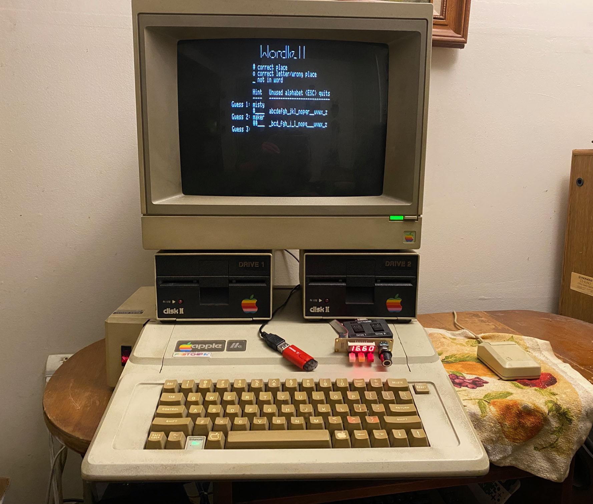

---


<!--
Wordell is a Wordle clone for Apple II written in
[CC65](https://cc65.github.io/doc/apple2.html) and Assembly.
It features 2,315 possible unique games. It requires 64kb and an
80 column card. File system is [ProDOS 2.4.3](https://prodos8.com/).
The main target is Apple //e. It may work on a ][+ with an 80 column
card, but that hasn't been tested. All testing was done on real
hardware running
[Apple II Desktop](https://www.a2desktop.com/).
-->
𝖶𝗈𝗋𝖽𝖾𝗅𝗅 𝗂𝗌 𝖺 𝖶𝗈𝗋𝖽𝗅𝖾 𝖼𝗅𝗈𝗇𝖾 𝖿𝗈𝗋 𝖠𝗉𝗉𝗅𝖾 𝖨𝖨 𝗐𝗋𝗂𝗍𝗍𝖾𝗇 𝗂𝗇
[𝖢𝖢𝟨𝟧](https://cc65.github.io/doc/apple2.html) 𝖺𝗇𝖽 𝖠𝗌𝗌𝖾𝗆𝖻𝗅𝗒.
𝖨𝗍 𝖿𝖾𝖺𝗍𝗎𝗋𝖾𝗌 𝟤,𝟥𝟣𝟧 𝗉𝗈𝗌𝗌𝗂𝖻𝗅𝖾 𝗎𝗇𝗂𝗊𝗎𝖾 𝗀𝖺𝗆𝖾𝗌. 𝖨𝗍 𝗋𝖾𝗊𝗎𝗂𝗋𝖾𝗌 𝟨𝟦𝗄𝖻 𝖺𝗇𝖽 𝖺𝗇
𝟪𝟢 𝖼𝗈𝗅𝗎𝗆𝗇 𝖼𝖺𝗋𝖽. 𝖥𝗂𝗅𝖾 𝗌𝗒𝗌𝗍𝖾𝗆 𝗂𝗌 [𝖯𝗋𝗈𝖣𝖮𝖲 𝟤.𝟦.𝟥](https://prodos8.com/).
𝖳𝗁𝖾 𝗆𝖺𝗂𝗇 𝗍𝖺𝗋𝗀𝖾𝗍 𝗂𝗌 𝖠𝗉𝗉𝗅𝖾 //𝖾. 𝖨𝗍 𝗆𝖺𝗒 𝗐𝗈𝗋𝗄 𝗈𝗇 𝖺 ][+ 𝗐𝗂𝗍𝗁 𝖺𝗇 𝟪𝟢 𝖼𝗈𝗅𝗎𝗆𝗇
𝖼𝖺𝗋𝖽, 𝖻𝗎𝗍 𝗍𝗁𝖺𝗍 𝗁𝖺𝗌𝗇'𝗍 𝖻𝖾𝖾𝗇 𝗍𝖾𝗌𝗍𝖾𝖽. 𝖠𝗅𝗅 𝗍𝖾𝗌𝗍𝗂𝗇𝗀 𝗐𝖺𝗌 𝖽𝗈𝗇𝖾 𝗈𝗇 𝗋𝖾𝖺𝗅
𝗁𝖺𝗋𝖽𝗐𝖺𝗋𝖾 𝗋𝗎𝗇𝗇𝗂𝗇𝗀
[𝖠𝗉𝗉𝗅𝖾 𝖨𝖨 𝖣𝖾𝗌𝗄𝗍𝗈𝗉]((https://www.a2desktop.com/).

---

<!-- 
Shoutout to other Wordle clones for Apple II:
Untitled Word Game Pro
by 4am
-->
### 𝖲𝗁𝗈𝗎𝗍𝗈𝗎𝗍 𝗍𝗈 𝗈𝗍𝗁𝖾𝗋 𝖶𝗈𝗋𝖽𝗅𝖾 𝖼𝗅𝗈𝗇𝖾𝗌 𝖿𝗈𝗋 𝖠𝗉𝗉𝗅𝖾 𝖨𝖨:
[Uɴᴛɪᴛʟᴇᴅ Wᴏʀᴅ Gᴀᴍᴇ Pʀᴏ](https://github.com/a2-4am/untitled-word-game-pro)
𝚋𝚢 𝟺𝚊𝚖<br><br>

---
<!--
### Wordell for Apple II is also the base code for all other versions of Wordell
-->
### 𝖶𝗈𝗋𝖽𝖾𝗅𝗅 𝖿𝗈𝗋 𝖠𝗉𝗉𝗅𝖾 𝖨𝖨 𝗂𝗌 𝖺𝗅𝗌𝗈 𝗍𝗁𝖾 𝖻𝖺𝗌𝖾 𝖼𝗈𝖽𝖾 𝖿𝗈𝗋 𝖺𝗅𝗅 𝗈𝗍𝗁𝖾𝗋 𝗏𝖾𝗋𝗌𝗂𝗈𝗇𝗌 𝗈𝖿 𝖶𝗈𝗋𝖽𝖾𝗅𝗅

<!--  
Currently these are:
Wordell for MS-DOS 3.3
Wordell for Windows 1.0
Wordell for Windows 2.0
-->
𝖢𝗎𝗋𝗋𝖾𝗇𝗍𝗅𝗒 𝗍𝗁𝖾𝗌𝖾 𝖺𝗋𝖾:

[Wᴏʀᴅᴇʟʟ ꜰᴏʀ MS-DOS 3.3](https://github.com/mpower-codeworks/WORDELL-Wordle-Clone-for-MS-DOS-3.3)

[Wᴏʀᴅᴇʟʟ ꜰᴏʀ Wɪɴᴅᴏᴡꜱ 1.0](https://github.com/mpower-codeworks/WORDELL-Wordle-Clone-for-Windows-1.0)

[Wᴏʀᴅᴇʟʟ ꜰᴏʀ Wɪɴᴅᴏᴡꜱ 2.0](https://github.com/mpower-codeworks/WORDELL-Wordle-Clone-for-Windows-2.0)


<!-- ### Screenshots -->
## 𝖲𝖼𝗋𝖾𝖾𝗇𝗌𝗁𝗈𝗍𝗌 

<table>
    <tr>
        <td align="left" width="50%" valign="middle">
            <br>
        </td>
        <td align="left" width="50%" valign="middle">
            <br>
        </td>
    </tr>
    <tr>
        <td align="left" width="50%" valign="middle">
            <br>
        </td>
        <td align="left" width="50%" valign="middle">
            <br>
        </td>
    </tr>
</table>


<!-- Wordell uses two word lists: -->
## 𝖶𝗈𝗋𝖽𝖾𝗅𝗅 𝗎𝗌𝖾𝗌 𝗍𝗐𝗈 𝗐𝗈𝗋𝖽 𝗅𝗂𝗌𝗍𝗌:

<!--  
- `ALL.TXT` - 12,947 words accepted as guesses.
- `SOLUTION.TXT` - 2,315 words that can be selected as answers.

The Apple II does not read these text files directly. They
are converted on a modern PC into fixed 5-byte records.

At startup Wordell opens `ALL5.BIN` and `SOL5.BIN`. Pressing **S**
starts a timer-based random seed. A solution number is selected and
exactly five bytes are read from `SOL5.BIN`.

Guess validation is kept small and fast. Only the matching first-letter
group from `ALL5.BIN` is loaded into RAM. `FASTWORD.S` then searches
that RAM buffer in 6502 assembly.
-->
- `𝖠𝖫𝖫.𝖳𝖷𝖳` - 𝟣𝟤,𝟫𝟦𝟩 𝗐𝗈𝗋𝖽𝗌 𝖺𝖼𝖼𝖾𝗉𝗍𝖾𝖽 𝖺𝗌 𝗀𝗎𝖾𝗌𝗌𝖾𝗌.
- `𝖲𝖮𝖫𝖴𝖳𝖨𝖮𝖭.𝖳𝖷𝖳` - 𝟤,𝟥𝟣𝟧 𝗐𝗈𝗋𝖽𝗌 𝗍𝗁𝖺𝗍 𝖼𝖺𝗇 𝖻𝖾 𝗌𝖾𝗅𝖾𝖼𝗍𝖾𝖽 𝖺𝗌 𝖺𝗇𝗌𝗐𝖾𝗋𝗌.

𝖳𝗁𝖾 𝖠𝗉𝗉𝗅𝖾 𝖨𝖨 𝖽𝗈𝖾𝗌 𝗇𝗈𝗍 𝗋𝖾𝖺𝖽 𝗍𝗁𝖾𝗌𝖾 𝗍𝖾𝗑𝗍 𝖿𝗂𝗅𝖾𝗌 𝖽𝗂𝗋𝖾𝖼𝗍𝗅𝗒. 𝖳𝗁𝖾𝗒
𝖺𝗋𝖾 𝖼𝗈𝗇𝗏𝖾𝗋𝗍𝖾𝖽 𝗈𝗇 𝖺 𝗆𝗈𝖽𝖾𝗋𝗇 𝖯𝖢 𝗂𝗇𝗍𝗈 𝖿𝗂𝗑𝖾𝖽 𝟧-𝖻𝗒𝗍𝖾 𝗋𝖾𝖼𝗈𝗋𝖽𝗌.

𝖠𝗍 𝗌𝗍𝖺𝗋𝗍𝗎𝗉 𝖶𝗈𝗋𝖽𝖾𝗅𝗅 𝗈𝗉𝖾𝗇𝗌 `𝖠𝖫𝖫𝟧.𝖡𝖨𝖭` 𝖺𝗇𝖽 `𝖲𝖮𝖫𝟧.𝖡𝖨𝖭`. 𝖯𝗋𝖾𝗌𝗌𝗂𝗇𝗀 **𝖲**
𝗌𝗍𝖺𝗋𝗍𝗌 𝖺 𝗍𝗂𝗆𝖾𝗋-𝖻𝖺𝗌𝖾𝖽 𝗋𝖺𝗇𝖽𝗈𝗆 𝗌𝖾𝖾𝖽. 𝖠 𝗌𝗈𝗅𝗎𝗍𝗂𝗈𝗇 𝗇𝗎𝗆𝖻𝖾𝗋 𝗂𝗌 𝗌𝖾𝗅𝖾𝖼𝗍𝖾𝖽 𝖺𝗇𝖽
𝖾𝗑𝖺𝖼𝗍𝗅𝗒 𝖿𝗂𝗏𝖾 𝖻𝗒𝗍𝖾𝗌 𝖺𝗋𝖾 𝗋𝖾𝖺𝖽 𝖿𝗋𝗈𝗆 `𝖲𝖮𝖫𝟧.𝖡𝖨𝖭`.

𝖦𝗎𝖾𝗌𝗌 𝗏𝖺𝗅𝗂𝖽𝖺𝗍𝗂𝗈𝗇 𝗂𝗌 𝗄𝖾𝗉𝗍 𝗌𝗆𝖺𝗅𝗅 𝖺𝗇𝖽 𝖿𝖺𝗌𝗍. 𝖮𝗇𝗅𝗒 𝗍𝗁𝖾 𝗆𝖺𝗍𝖼𝗁𝗂𝗇𝗀 𝖿𝗂𝗋𝗌𝗍-𝗅𝖾𝗍𝗍𝖾𝗋
𝗀𝗋𝗈𝗎𝗉 𝖿𝗋𝗈𝗆 `𝖠𝖫𝖫𝟧.𝖡𝖨𝖭` 𝗂𝗌 𝗅𝗈𝖺𝖽𝖾𝖽 𝗂𝗇𝗍𝗈 𝖱𝖠𝖬. `𝖥𝖠𝖲𝖳𝖶𝖮𝖱𝖣.𝖲` 𝗍𝗁𝖾𝗇 𝗌𝖾𝖺𝗋𝖼𝗁𝖾𝗌
𝗍𝗁𝖺𝗍 𝖱𝖠𝖬 𝖻𝗎𝖿𝖿𝖾𝗋 𝗂𝗇 𝟨𝟧𝟢𝟤 𝖺𝗌𝗌𝖾𝗆𝖻𝗅𝗒.

<!--  
## Hints use:

- `#` - correct letter and position
- `o` - correct letter, wrong position
- `_` - letter not in the word

Used letters are removed from the visible
alphabet as the game progresses.
-->
## 𝖧𝗂𝗇𝗍𝗌 𝗎𝗌𝖾:

- `#` - 𝖼𝗈𝗋𝗋𝖾𝖼𝗍 𝗅𝖾𝗍𝗍𝖾𝗋 𝖺𝗇𝖽 𝗉𝗈𝗌𝗂𝗍𝗂𝗈𝗇
- `𝗈` - 𝖼𝗈𝗋𝗋𝖾𝖼𝗍 𝗅𝖾𝗍𝗍𝖾𝗋, 𝗐𝗋𝗈𝗇𝗀 𝗉𝗈𝗌𝗂𝗍𝗂𝗈𝗇
- `_` - 𝗅𝖾𝗍𝗍𝖾𝗋 𝗇𝗈𝗍 𝗂𝗇 𝗍𝗁𝖾 𝗐𝗈𝗋𝖽

𝖴𝗌𝖾𝖽 𝗅𝖾𝗍𝗍𝖾𝗋𝗌 𝖺𝗋𝖾 𝗋𝖾𝗆𝗈𝗏𝖾𝖽 𝖿𝗋𝗈𝗆 𝗍𝗁𝖾 𝗏𝗂𝗌𝗂𝖻𝗅𝖾
𝖺𝗅𝗉𝗁𝖺𝖻𝖾𝗍 𝖺𝗌 𝗍𝗁𝖾 𝗀𝖺𝗆𝖾 𝗉𝗋𝗈𝗀𝗋𝖾𝗌𝗌𝖾𝗌.


<!--  
Player stats are recorded in `WORDLE.INI` at the end
of each game. These can be reset to zero at any time.
-->
𝖯𝗅𝖺𝗒𝖾𝗋 𝗌𝗍𝖺𝗍𝗌 𝖺𝗋𝖾 𝗋𝖾𝖼𝗈𝗋𝖽𝖾𝖽 𝗂𝗇 `𝖶𝖮𝖱𝖣𝖫𝖤.𝖨𝖭𝖨` 𝖺𝗍 𝗍𝗁𝖾 𝖾𝗇𝖽
𝗈𝖿 𝖾𝖺𝖼𝗁 𝗀𝖺𝗆𝖾. 𝖳𝗁𝖾𝗌𝖾 𝖼𝖺𝗇 𝖻𝖾 𝗋𝖾𝗌𝖾𝗍 𝗍𝗈 𝗓𝖾𝗋𝗈 𝖺𝗍 𝖺𝗇𝗒 𝗍𝗂𝗆𝖾.<br><br>


<!--
### You don't need to do this unless you wish to make new word/soplution lists.

`MAKEPACK.C` is a Windows tool. It converts the normal
text word lists into the files used by the Apple II
version.

It reads:
-->
### 𝖸𝗈𝗎 𝖽𝗈𝗇'𝗍 𝗇𝖾𝖾𝖽 𝗍𝗈 𝖽𝗈 𝗍𝗁𝗂𝗌 𝗎𝗇𝗅𝖾𝗌𝗌 𝗒𝗈𝗎 𝗐𝗂𝗌𝗁 𝗍𝗈 𝗆𝖺𝗄𝖾 𝗇𝖾𝗐 𝗐𝗈𝗋𝖽/𝗌𝗈𝗉𝗅𝗎𝗍𝗂𝗈𝗇 𝗅𝗂𝗌𝗍𝗌.

`𝖬𝖠𝖪𝖤𝖯𝖠𝖢𝖪.𝖢` 𝗂𝗌 𝖺 𝖶𝗂𝗇𝖽𝗈𝗐𝗌 𝗍𝗈𝗈𝗅. 𝖨𝗍 𝖼𝗈𝗇𝗏𝖾𝗋𝗍𝗌 𝗍𝗁𝖾 𝗇𝗈𝗋𝗆𝖺𝗅
𝗍𝖾𝗑𝗍 𝗐𝗈𝗋𝖽 𝗅𝗂𝗌𝗍𝗌 𝗂𝗇𝗍𝗈 𝗍𝗁𝖾 𝖿𝗂𝗅𝖾𝗌 𝗎𝗌𝖾𝖽 𝖻𝗒 𝗍𝗁𝖾 𝖠𝗉𝗉𝗅𝖾 𝖨𝖨
𝗏𝖾𝗋𝗌𝗂𝗈𝗇.

𝖨𝗍 𝗋𝖾𝖺𝖽𝗌:

```text
𝖠𝖫𝖫.𝖳𝖷𝖳
𝖲𝖮𝖫𝖴𝖳𝖨𝖮𝖭.𝖳𝖷𝖳
```

It writes:

```text
𝖠𝖫𝖫𝟧.𝖡𝖨𝖭
𝖲𝖮𝖫𝟧.𝖡𝖨𝖭
𝖶𝖮𝖱𝖣𝖣𝖠𝖳𝖠.𝖧
```
<!--  
Each packed word is exactly five bytes. No
CR, LF, or zero terminator is stored.

`WORDDATA.H` is generated at the same time. It contains
the solution count plus the offset and size of each
starting-letter group in `ALL5.BIN`.

`ALL.TXT` must remain grouped by starting letter.
`MAKEPACK.C` packs the list as supplied; it does
not sort it.


I know, I know... why not 40 columns? I just like 80, that's all.
I guess mode-switching is one idea, but it could get tricky unless
Wordell always starts in 40 column mode, and I prefer the "80" look.

The repositioning would be easy. If Wordell could detect the screen
mode and then auto-adjust, that would be fantastic. Maybe that'll be
version 2.0.
-->
𝖤𝖺𝖼𝗁 𝗉𝖺𝖼𝗄𝖾𝖽 𝗐𝗈𝗋𝖽 𝗂𝗌 𝖾𝗑𝖺𝖼𝗍𝗅𝗒 𝖿𝗂𝗏𝖾 𝖻𝗒𝗍𝖾𝗌. 𝖭𝗈
𝖢𝖱, 𝖫𝖥, 𝗈𝗋 𝗓𝖾𝗋𝗈 𝗍𝖾𝗋𝗆𝗂𝗇𝖺𝗍𝗈𝗋 𝗂𝗌 𝗌𝗍𝗈𝗋𝖾𝖽.

`𝖶𝖮𝖱𝖣𝖣𝖠𝖳𝖠.𝖧` 𝗂𝗌 𝗀𝖾𝗇𝖾𝗋𝖺𝗍𝖾𝖽 𝖺𝗍 𝗍𝗁𝖾 𝗌𝖺𝗆𝖾 𝗍𝗂𝗆𝖾. 𝖨𝗍 𝖼𝗈𝗇𝗍𝖺𝗂𝗇𝗌
𝗍𝗁𝖾 𝗌𝗈𝗅𝗎𝗍𝗂𝗈𝗇 𝖼𝗈𝗎𝗇𝗍 𝗉𝗅𝗎𝗌 𝗍𝗁𝖾 𝗈𝖿𝖿𝗌𝖾𝗍 𝖺𝗇𝖽 𝗌𝗂𝗓𝖾 𝗈𝖿 𝖾𝖺𝖼𝗁
𝗌𝗍𝖺𝗋𝗍𝗂𝗇𝗀-𝗅𝖾𝗍𝗍𝖾𝗋 𝗀𝗋𝗈𝗎𝗉 𝗂𝗇 `𝖠𝖫𝖫𝟧.𝖡𝖨𝖭`.

`𝖠𝖫𝖫.𝖳𝖷𝖳` 𝗆𝗎𝗌𝗍 𝗋𝖾𝗆𝖺𝗂𝗇 𝗀𝗋𝗈𝗎𝗉𝖾𝖽 𝖻𝗒 𝗌𝗍𝖺𝗋𝗍𝗂𝗇𝗀 𝗅𝖾𝗍𝗍𝖾𝗋.
`𝖬𝖠𝖪𝖤𝖯𝖠𝖢𝖪.𝖢` 𝗉𝖺𝖼𝗄𝗌 𝗍𝗁𝖾 𝗅𝗂𝗌𝗍 𝖺𝗌 𝗌𝗎𝗉𝗉𝗅𝗂𝖾𝖽; 𝗂𝗍 𝖽𝗈𝖾𝗌
𝗇𝗈𝗍 𝗌𝗈𝗋𝗍 𝗂𝗍.


𝖨 𝗄𝗇𝗈𝗐, 𝖨 𝗄𝗇𝗈𝗐... 𝗐𝗁𝗒 𝗇𝗈𝗍 𝟦𝟢 𝖼𝗈𝗅𝗎𝗆𝗇𝗌? 𝖨 𝗃𝗎𝗌𝗍 𝗅𝗂𝗄𝖾 𝟪𝟢, 𝗍𝗁𝖺𝗍'𝗌 𝖺𝗅𝗅.
𝖨 𝗀𝗎𝖾𝗌𝗌 𝗆𝗈𝖽𝖾-𝗌𝗐𝗂𝗍𝖼𝗁𝗂𝗇𝗀 𝗂𝗌 𝗈𝗇𝖾 𝗂𝖽𝖾𝖺, 𝖻𝗎𝗍 𝗂𝗍 𝖼𝗈𝗎𝗅𝖽 𝗀𝖾𝗍 𝗍𝗋𝗂𝖼𝗄𝗒 𝗎𝗇𝗅𝖾𝗌𝗌
𝖶𝗈𝗋𝖽𝖾𝗅𝗅 𝖺𝗅𝗐𝖺𝗒𝗌 𝗌𝗍𝖺𝗋𝗍𝗌 𝗂𝗇 𝟦𝟢 𝖼𝗈𝗅𝗎𝗆𝗇 𝗆𝗈𝖽𝖾, 𝖺𝗇𝖽 𝖨 𝗉𝗋𝖾𝖿𝖾𝗋 𝗍𝗁𝖾 "𝟪𝟢" 𝗅𝗈𝗈𝗄.

𝖳𝗁𝖾 𝗋𝖾𝗉𝗈𝗌𝗂𝗍𝗂𝗈𝗇𝗂𝗇𝗀 𝗐𝗈𝗎𝗅𝖽 𝖻𝖾 𝖾𝖺𝗌𝗒. 𝖨𝖿 𝖶𝗈𝗋𝖽𝖾𝗅𝗅 𝖼𝗈𝗎𝗅𝖽 𝖽𝖾𝗍𝖾𝖼𝗍 𝗍𝗁𝖾 𝗌𝖼𝗋𝖾𝖾𝗇
𝗆𝗈𝖽𝖾 𝖺𝗇𝖽 𝗍𝗁𝖾𝗇 𝖺𝗎𝗍𝗈-𝖺𝖽𝗃𝗎𝗌𝗍, 𝗍𝗁𝖺𝗍 𝗐𝗈𝗎𝗅𝖽 𝖻𝖾 𝖿𝖺𝗇𝗍𝖺𝗌𝗍𝗂𝖼. 𝖬𝖺𝗒𝖻𝖾 𝗍𝗁𝖺𝗍'𝗅𝗅 𝖻𝖾
𝗏𝖾𝗋𝗌𝗂𝗈𝗇 𝟤.𝟢.

.ɱքøωɇɍ-ƈøđɇωøɍҟֆ
